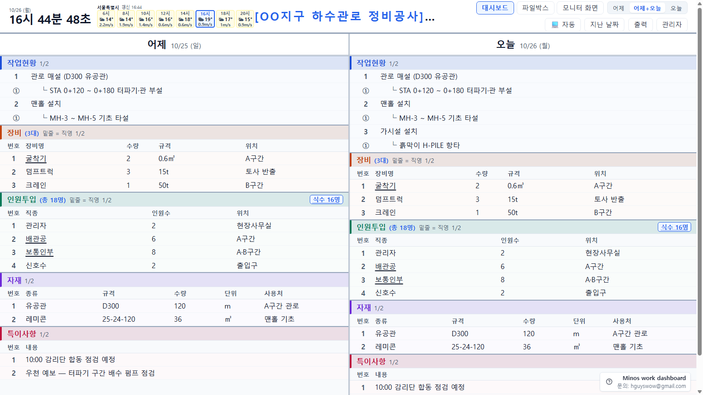
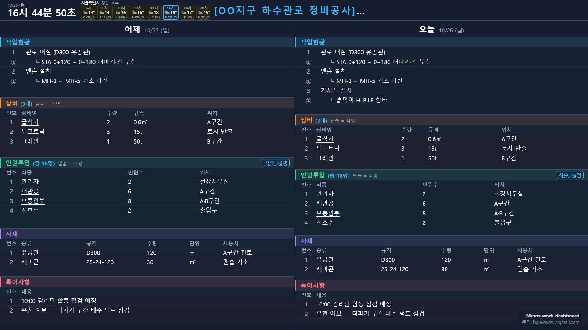
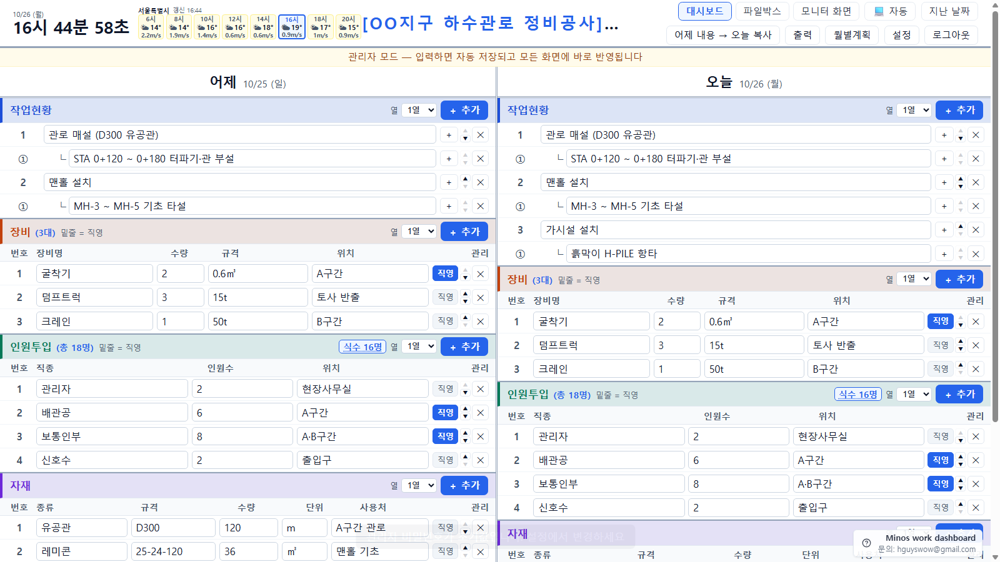
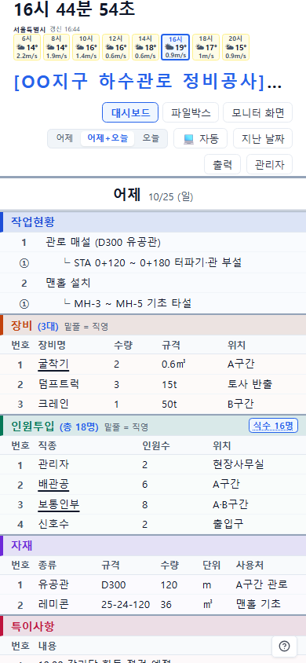
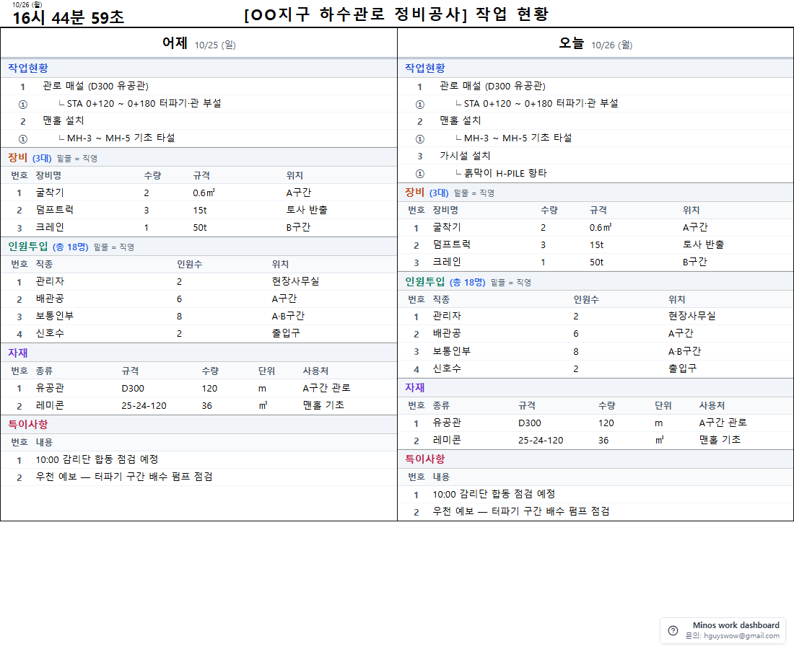

# 작업현황 대시보드 v2 (Work Dashboard)

건설현장 사무실 및 대형 디스플레이(TV)에 당일/전일 작업 현황, 장비, 인원, 자재 및 날씨 정보를 실시간 표출하고 웹에서 간편하게 관리하는 현장 대시보드 시스템입니다.

---

## 화면 미리보기

> 아래 화면은 가상의 예시 데이터(OO지구 하수관로 정비공사)로 만든 것입니다.

| 사무실 PC 조회 화면 (어제 + 오늘) | 현장 TV 모니터 화면 (/tv, 다크) |
|---|---|
|  |  |

| 관리자 입력 화면 | 스마트폰 화면 |
|---|---|
|  |  |

| 일일 보고서 출력(인쇄/PDF) |
|---|
|  |

---

## 0. Windows 설치 프로그램 (간편 설치본)

Node.js를 별도로 설치하지 않고 바로 사용할 수 있는 원클릭 Windows 설치 패키지(`WorkDashboard-Setup-1.1.0.exe`)를 제공합니다.

- **설치 및 구동**: 설치 마법사를 실행하면 관리자 권한 없이 사용자 영역(`%LOCALAPPDATA%\Programs\WorkDashboard`)에 설치되며, 윈도우 시작 시 트레이 아이콘 백그라운드 자동 실행이 지원됩니다.
- **데이터 보관 위치**: 작업 데이터 및 설정은 프로그램 업데이트 및 재설치 시에도 안전하게 보존되도록 사용자 로컬 앱데이터 폴더(`%LOCALAPPDATA%\WorkDashboard`)에 분리 저장됩니다 (`data.json`, `work.db`, `config.json`, `files/`, `backup/`).
- **마스터 비밀번호 확인**: 최초 실행 시 시스템에서 임의 생성된 안전한 마스터 복구 키가 `%LOCALAPPDATA%\WorkDashboard\config.json`의 `masterPassword` 항목에 자동 기록됩니다 (비밀번호 분실 시 해당 파일에서 확인 가능).
- **외부 PC 접속**: 동일 현장 네트워크의 다른 PC나 태블릿에서 접속하려면 2절의 Windows 방화벽 포트(3000) 인바운드 허용 규칙을 1회 등록해 주세요.

---

## 1. 실행 및 접속 방법

### 1) 서버 실행
- **운영 실행**: 프로젝트 폴더의 **`start.bat`** 파일을 더블 클릭하여 메뉴(모니터용, 사용자용, 서버만)를 선택해 실행합니다.
- **개발 모드 실행**: 프로젝트 폴더의 **`start_dev.bat`** 파일을 실행하면 코드 변경 시 서버 자동 재시작(`node --watch`) 및 브라우저 자동 새로고침(실시간 반영)이 동작합니다. (편집 중에는 데이터 유실 방지를 위해 새로고침 대신 안내 배너가 표시됩니다.)
- 콘솔 창이 열리며 접속 가능한 주소 목록이 표시됩니다.
- 서버를 종료하려면 콘솔 창을 닫거나 `Ctrl + C`를 누릅니다.

### 2) 화면 접속 및 모드 분리
- **현장 TV 전용 화면 (모니터링 전용)**: `http://<서버PC_IP>:3000/tv`
  - 대형 디스플레이 표출에 최적화된 **고정 레이아웃(스크롤바 없음)**과 **구역별 10초 자동 페이지 순환**이 작동합니다.
  - 관리자 버튼, 설정 창, 파일박스 링크 등이 일체 노출되지 않는 **순수 모니터링 전용 화면**입니다.
  - 마우스를 움직이면 우측 상단에 **`[어제 | 어제+오늘 | 오늘]`** 보기 모드 세그먼트 버튼과 **`☀/🌙 테마`**, **`⛶ 전체 화면 (F11)`** 버튼이 3초간 나타나며, URL 파라미터(`?view=today|yesterday|both`)로 특정 칸 고정 표출도 지원합니다.
- **사용자용 화면 (사무실 PC / 스마트폰 조회 및 관리)**: `http://<서버PC_IP>:3000`
  - 일반 웹 문서 흐름으로 **전체 내용이 한눈에 표시**되며, 헤더의 **`[어제 | 어제+오늘 | 오늘]`** 보기 선택으로 특정 칸을 100% 전체 폭으로 확대 조회할 수 있습니다 (관리자 모드 시 숨김).
  - 브라우저를 200% 이상 확대해도 가로 스크롤 넘침 없이 안정적으로 읽을 수 있습니다.
  - 상단 헤더에 **`대시보드`(`/`), `파일박스`(`/files`), `모니터 화면`(`/tv`, 새 창)** 메뉴 링크 및 관리자 로그인 버튼이 제공됩니다.
- **서버 PC 본체**: `http://localhost:3000` (또는 TV 모드: `http://localhost:3000/tv`)
  - 서버 PC의 IP 주소는 서버 콘솔 창 또는 화면 좌측 하단에 자동으로 실시간 표시되며, 화면 우측 하단에는 프로그램 이름(Minos work dashboard), 문의처 및 프로그램 상세 가이드 링크(`/guide.html`)가 고정 안내됩니다.

---

## 2. Windows 방화벽 설정 (포트 3000 허용)

다른 PC나 현장 TV에서 대시보드에 접속하려면 서버 PC에서 포트 3000 인바운드를 1회 허용해야 합니다.

### PowerShell로 간편 등록 (관리자 권한)
1. 시작 버튼 우클릭 → **PowerShell(관리자)** 또는 **터미널(관리자)** 실행
2. 아래 명령어를 복사하여 붙여넣고 엔터를 누릅니다:
   ```powershell
   New-NetFirewallRule -DisplayName "Work Dashboard (3000)" -Direction Inbound -LocalPort 3000 -Protocol TCP -Action Allow
   ```

*(또는 제어판 → Windows Defender 방화벽 → 고급 설정 → 인바운드 규칙 → 새 규칙 → 포트 → TCP 3000 허용)*

---

## 3. PC 부팅 시 자동 시작 설정

현장 모니터링 PC가 켜질 때 서버가 자동으로 실행되도록 설정하는 방법입니다.

1. 키보드의 `Win + R` 키를 누르고 **`shell:startup`** 입력 후 엔터를 칩니다 (시작프로그램 폴더가 열립니다).
2. `work-dashboard` 폴더의 **`start.bat`** 파일을 마우스 우클릭하여 **'바로 가기 만들기'**를 클릭합니다.
3. 생성된 바로 가기 파일을 1번에서 열린 시작프로그램 폴더 안으로 이동시킵니다.
4. **TV 브라우저 자동 시작**: Chrome이나 Edge 브라우저의 바로 가기를 시작프로그램 폴더에 넣고, 대상 경로 끝에 `--kiosk http://localhost:3000/tv`를 붙여두면 부팅 즉시 TV 화면이 전체화면으로 실행됩니다.
※ 시작프로그램은 Windows에 로그인된 뒤에 실행되므로, PC가 부팅 후 자동 로그인되도록 설정되어 있어야 합니다.

---

## 4. 관리자 화면 조작 가이드

### 1) 관리자 로그인 및 세션
- 화면 우측 상단의 **`관리자`** 버튼(옅은 글씨)을 누르고 비밀번호를 입력합니다. (로그인 창 제목: `관리자 로그인`)
- 비밀번호 및 포트 번호는 **`config.json`** 파일에서 설정할 수 있습니다. (현재 기본 비밀번호는 관리자 `password` 및 사무실 `officePassword` 모두 `0000`으로 설정되어 있으며, 실운영 전 보안을 위해 반드시 변경을 권장합니다.)
- **세션 주의사항**: 서버를 재시작하면 로그인 상태가 초기화되므로 다시 로그인해야 합니다 (작성된 데이터는 안전하게 보존됩니다).
- **편집 중 세션 만료 안내**: 작업 중 세션 만료 알림이 뜨면 브라우저를 새로고침하지 마시고 안내창의 재로그인을 진행해야 작성 중인 데이터 유실을 방지할 수 있습니다.

### 2) 데이터 자동 이월 동작
- 자정이 지나 날짜가 바뀌면, **오늘 칸은 가장 최근 작성된 기록의 복사본으로 자동 시작**되며 어제 칸은 그 직전 기록이 표시됩니다.
- 관리자가 오늘 작업 내용을 의도적으로 모두 지우고 빈 상태로 저장한 경우에는 당일 중 다시 채워지지 않습니다.

### 3) 입력 편의 기능
- **자동 번호 매김**: 작업현황 트리는 1단계 숫자(`1, 2...`), 2단계 원숫자(`①, ②...`), 3단계 한글 원문자(`㉮, ㉯...`) 순으로 자동 매겨지며, 표(장비/인원/자재/특이사항)는 `1, 2, 3...` 순으로 내용이 있는 행에 자동 부여됩니다.
- **자재 입력 양식**: 자재는 `번호 | 종류 | 규격 | 수량 | 단위 | 사용처`로 구성되며, 단위 입력 시 기본 12종 단위(`개, EA, m, ㎡, ㎥, kg, ton, 포, 본, 장, 롤, 세트`) 및 이전 입력 이력이 자동완성 추천으로 제공됩니다. 수량은 소수점(예: 2.5) 및 비정형 문자열("약 5톤") 입력도 안전하게 지원합니다.
- **자동완성**: 최근 180일간 입력된 이력을 기반으로 입력창 클릭 시 추천 목록이 드롭다운으로 제공됩니다.
- **빠른 행 추가 (Enter)**: 표의 마지막 칸에서 `Enter` 키를 누르면 자동으로 다음 행이 생성되고 포커스가 이동합니다.
- **`어제 내용 → 오늘 복사` 버튼**: 상단의 **`어제 내용 → 오늘 복사`** 버튼을 누르면 어제 작업 데이터를 오늘 입력 양식으로 즉시 불러옵니다.
- **구역 열 배치 · 순서 · 전체 폭 · 내부 다단 (WD-9)**: 상단 `설정` 창의 ⑤번 항목에서 열 수(1열/2열/3열), 5개 구역(작업현황/장비/인원/자재/특이사항)의 순서 변경(▲/▼), 전체 폭 확장 여부, 구역 내부 다단(자동 0단, 1단, 2단, 3단)을 자유롭게 지정할 수 있습니다. 좁은 칸 또는 다단 내부에서는 2단 컴팩트 카드로 자동 전환되어 글자 잘림 없이 표시됩니다. (관리자 편집 모드에서는 입력 편의를 위해 항상 1열 세로로 표시되며 지정한 순서가 그대로 유지됩니다.)

---

## 5. 날씨 기능 및 설정

상단 우측의 **`설정`** 버튼(관리자 전용)에서 현장명과 날씨를 설정할 수 있습니다.

### 1) 날씨 자동 수신 (Open-Meteo)
- 서버 PC가 인터넷에 연결되어 있으면 별도 API 키 없이 30분 간격으로 당일 6~20시(2시간 간격 8칸) 날씨를 자동 수신합니다.
- 설정 창의 **도시 검색**에서 한글은 주요 도시 20곳(서울, 부산, 대구, 인천, 광주, 대전, 울산, 세종, 수원, 성남, 고양, 용인, 부천, 안산, 청주, 천안, 전주, 포항, 창원, 제주)만 지원하며, 그 밖의 지역은 영문 도시명 또는 위도·경도를 직접 입력합니다.

### 2) 오프라인 및 수동 날씨 입력
- 현장에 인터넷 연결이 불가능한 경우 설정 창 하단의 **'오늘 수동 날씨'** 8칸(날씨, 기온, 풍속)을 직접 입력하여 반영할 수 있습니다.
- 자동 날씨 데이터가 인터넷 장애 등으로 **3시간 이상 갱신되지 못하면 자동으로 수동 입력 데이터로 전환(fallback)**됩니다.

### 3) 강풍 / 강우 안전 경고
- 설정 창에서 강풍(m/s) 및 강우량(mm/h) 기준치를 설정할 수 있습니다. (값을 `0`으로 지정하면 해당 경고 기능이 꺼집니다.)
- 기준 초과 시 해당 시간대 슬롯이 붉은색으로 강조되며 경고 요약이 표출됩니다.

---

## 6. 데이터 저장, 백업 및 복원

### 1) 파일 구성
- **`data.json`**: 모든 작업 현황 데이터가 저장되는 핵심 데이터베이스 파일입니다.
- **`backup/data-YYYY-MM-DD.json`**: 일일 자동 백업 파일입니다.
  - **생성 시점**: 서버 시작 시(`data.json`이 정상 로드된 경우) 및 그날 첫 저장 시 생성됩니다.
  - 당일 백업 파일이 이미 존재하면 덮어쓰지 않으며, 날짜 형식 백업 파일은 최근 30개까지만 유지되고 오래된 파일은 자동 정리됩니다.
- **`data.json.corrupt-<시각>`**: 서버 시작 시 파일 손상(빈 파일, JSON 문법 오류 등) 감지 시 기존 원본을 보호하기 위해 복사된 파일입니다.
- **`data.json.premigrate-<시각>`**: 구형 버전 데이터를 v2 규격으로 변환하기 직전에 생성된 변환 전 원본 파일입니다.
- ※ `corrupt` 및 `premigrate` 파일은 자동으로 삭제되지 않으므로, 확인 후 관리자가 직접 삭제하시면 됩니다.

### 2) 백업 데이터 복원 절차
1. 실행 중인 콘솔 창을 닫아 서버를 완전히 종료합니다.
2. `backup/` 폴더에서 복원하고자 하는 날짜의 백업 파일(예: `data-2026-10-20.json`)을 복사합니다.
3. 프로젝트 루트 폴더에 붙여넣고 파일 이름을 **`data.json`**으로 변경(덮어쓰기)합니다.
4. `start.bat`을 실행하여 서버를 다시 시작합니다.

---

## 7. TV 현장 대형 화면 운영 팁
 
- **전체 화면 전환/해제**: 현장 모니터/TV의 웹 브라우저에서 키보드 **`F11`** 키를 누르거나, 화면 우측 상단에 마우스를 올리면 나타나는 **`⛶ 전체 화면`** 버튼을 클릭하여 주소창 없는 전체 화면으로 전환할 수 있습니다. 원래 창 크기로 되돌리려면 키보드 **`Esc`** 또는 **`F11`** 키를 누릅니다.
- **화면 꺼짐 방지**: Windows 설정 → 시스템 → 전원 및 배터리에서 **"화면 끄기"** 및 **"절전 모드"**를 **'안 함(Never)'**으로 설정하십시오.
- **모니터 전용 고정 레이아웃 (스크롤 없음)**: TV 전용 주소(`/tv`)는 브라우저 뷰포트 높이 안에 화면 전체가 고정되어 위아래 스크롤바가 생기지 않습니다. 상단 헤더, 어제/오늘 머리글, 구역 제목, 표 머리글은 항상 제자리에 고정됩니다. (반면 사용자용 주소 `/`는 일반 웹 문서처럼 전체 행이 세로로 길게 표시되어 자유롭게 스크롤할 수 있습니다.)
- **구역별 10초 자동 내용 순환 (`/tv` 전용)**: 구역 내부 다단(1~3단 또는 자동)으로 공간을 최적화하며, 다단으로도 내용이 가용 높이를 넘는 구역(작업현황, 장비, 인원, 자재, 특이사항)은 내용 부분만 10초마다 다음 페이지로 자동 순환 표시됩니다. 2페이지 이상인 구역 제목 옆에는 `1/N` 페이지 배지가 표출됩니다.
- **구역 높이 직접 조절 및 저장 (WD-18)**:
  - 인접한 두 구역(행) 사이 경계선을 마우스나 터치로 드래그하여 각 구역의 높이 비율을 자유롭게 늘리거나 줄일 수 있습니다 (더블클릭 시 자동 균등 복원).
  - 내부 열 설정이 '자동'(0)인 구역은 높이가 줄어들면 1단 → 2단 → 3단으로 열이 자동 추가되어 내용을 최대한 한눈에 보여주며, 높이를 늘리면 1단으로 자연스럽게 복귀합니다.
  - 조절 후 하단 바의 **`[저장]`**을 클릭하면 관리자 비밀번호 확인(비로그인 상태)을 거쳐 서버에 저장되며, 모든 모니터/화면에 실시간으로 동일하게 반영됩니다. (/tv에서는 인증 토큰이 보관되지 않고 1회 저장 후 즉시 폐기됩니다.)
- **자동 갱신**: 자정이 지나 날짜가 바뀌거나 관리자가 내용을 수정하면 실시간(SSE)으로 화면이 자동 갱신됩니다.

---

## 8. 월별 계획(달력 메모) 및 /tv 공고 알림 (WD-22, WD-26)

관리자 화면에서 현장의 월별 일정을 달력으로 관리하고, 주요 안전 공고나 긴급 안내를 현장 TV 화면 위에 뒷배경이 그대로 보이는 떠다니는 알림으로 즉시 또는 지정 시각에 자동 표출하는 기능입니다.

### 1) 월별 계획 관리 (달력 메모)
- **접근 방법**: 대시보드(`/`)에서 관리자로 로그인한 후 상단 헤더의 **`월별계획`** 버튼을 누릅니다. (TV 모드 및 비관리자 화면에는 노출되지 않습니다.)
- **달력 표출 및 일정 점(●)**:
  - 7열(일~토) 달력 그리드로 해당 월의 날짜가 표시되며, 이전달/다음달 이동 및 '오늘' 바로가기를 지원합니다.
  - **일정이 있는 날은 날짜 아래에 점(●)**이 표시됩니다.
    - 일반 일정만 있는 날: **회색 점(`●`)**
    - "공고로 표시"가 체크된 일정이 포함된 날: **하늘색 강조 점(`●`)**
- **일정 입력 및 수정**:
  - 달력에서 원하는 날짜를 클릭하면 우측에 해당 날짜의 상세 일정 목록이 열립니다.
  - `+ 일정 추가` 버튼으로 항목을 추가하고 내용을 입력합니다 (날짜당 최대 20개, 항목당 최대 200자).
  - 저장 시 유효하지 않은 입력은 자동으로 정제되며, 모달 창 하단의 **`[저장]`** 버튼을 누르면 서버에 반영됩니다.

### 2) 예약 공고 기능 (지정 시각 자동 표출)
- 일정 입력창에서 **"공고로 표시"** 체크박스를 선택하면 **시작 시각**(`HH:MM`)과 **지속 시간**(분, 1~720분, 기본 10분) 입력창이 활성화됩니다.
- 해당 시각이 되면 서버에서 실시간(SSE)으로 감지하여 **현장 TV(`/tv`) 화면 위로 뒷배경을 가리지 않는 떠다니는 알림 카드가 자동으로 표출**됩니다.
- 지정한 지속 시간이 경과하면 알림은 **자동으로 소멸**합니다.
- ※ **자정 경과 동작 스펙**: 예약 공고는 "당일(서버 로컬 날짜) 항목만 평가"하므로, 시작 시각과 지속 시간이 자정을 넘어가는 경우 다음날 0시(자정)에 공고가 자동 종료됩니다.

### 3) 즉시 공고 기능 (긴급 상황 알림)
- 월별계획 모달 하단의 **`🚨 TV 즉시 공고 (오버레이)`** 영역에서 즉시 띄울 공고 내용과 지속 시간(분)을 입력하고 **`[지금 표시]`**를 클릭합니다.
- 클릭 즉시 연결된 모든 현장 TV 화면에 뒷배경 대시보드가 가려지지 않는 떠다니는 알림 카드가 표출됩니다.
- 표출 중에는 남은 시간이 표시되며, 관리자가 **`[공고 해제]`** 버튼을 누르면 즉시 모든 TV에서 알림이 사라집니다.

### 4) TV 전용 화면 무결성 및 보안
- **/tv 레이아웃 간섭 0 및 배경 가림 0**: 공고 알림은 투명 레이어 위 부드럽게 떠다니는(floating) 카드로 띄워져 뒷배경 대시보드를 전혀 가리지 않으며, 기존 /tv의 스크롤 고정(`scrollHeight == innerHeight`, 오차 0px) 및 구역 순환 타이머에 일체 영향을 주지 않습니다.
- **다중 해상도 대응**: FHD(1920×1080), QHD(2560×1440), 4K(3840×2160) 등 대형 디스플레이 해상도에 맞춰 글자 크기와 여백이 유연하게 반응합니다 (`clamp()`).
- **XSS 보안 방어**: 공고 텍스트는 브라우저 네이티브 텍스트 노드로만 주입(`textContent`)되어 HTML이나 스크립트 삽입 공격이 원천 차단됩니다.
- **공개 접근 보호**: 인증 없는 클라이언트(`/tv`)는 현재 활성 공고(내용/만료시각)만 조회 가능하며, 전체 월별 계획 데이터는 노출되지 않습니다.

---

## 9. 파일박스 (사무실 파일 전달 창구)

대시보드 상단 우측의 **`파일박스`** 링크를 누르거나 브라우저에서 `/files`로 접속하면 사무실 파일을 안전하게 공유할 수 있는 파일 전달 창구를 이용할 수 있습니다.

### 1) 주요 기능 및 사용 권한
- **사무실 로그인 필수 (보안 강화)**: 파일 올리기(업로드), 파일 목록 조회, 다운로드, 브라우저 미리보기는 **사무실 로그인**(사무실 비밀번호 또는 관리자 비밀번호)을 거친 사용자만 이용할 수 있습니다 (보안 쿠키 세션).
- **관리자 자동 연동**: 대시보드(`/`)에서 이미 관리자로 로그인한 상태라면 파일박스 이동 시 별도의 로그인 과정 없이 자동으로 사무실 권한이 활성화됩니다.
- **사무실 비밀번호 설정**: `config.json` 파일에 `"officePassword": "원하는비밀번호"` 줄을 추가하여 지정할 수 있습니다. (설정하지 않은 경우 기본값 `0000`으로 동작합니다.)
- **삭제는 관리자 전용**: 불필요하거나 잘못 올라간 파일의 삭제는 관리자 권한(대시보드에서 로그인한 관리자 세션)이 있는 사용자만 수행할 수 있습니다 (사무실 비밀번호로는 삭제 불가).
- **업로드 용량 제한**: 단일 파일당 최대 **100MB**까지 업로드할 수 있습니다. (100MB 초과 파일은 업로드 전에 안내창과 함께 차단됩니다.)
- **보관 기간 및 용량 경고**: 보관 기간은 무제한(자동 삭제 없음)이며, 전체 저장 용량이 **5GB**를 초과하면 화면 상단에 경고 띠가 표출되어 오래된 파일 정리를 안내합니다.
- **화면 100% 크기 자동 보정 (WD-12)**: 대시보드(`/`)를 작게 보기 위해 브라우저 줌을 축소(예: 50%)해 둔 경우에도 파일박스 상단의 **"화면 100% 크기로 자동 보정"** 옵션(기본값 켜짐)을 통해 대시보드 줌과 무관하게 항상 정상 크기(100%)로 자동 표시됩니다. (체크 해제 시 수동 50~200% 배율 조절 가능, 브라우저에 자동 기억)

### 2) 미리보기 지원 형식
- **이미지**: PNG, JPG/JPEG, GIF, WebP, BMP (목록에서 작은 썸네일 제공)
- **문서**: PDF (브라우저 내장 뷰어)
- **텍스트**: TXT, LOG, CSV, MD, JSON (1MB 초과 파일은 앞부분 1MB만 표시, 메모장 한글 EUC-KR 자동 감지)
- **동영상 / 오디오**: MP4, WebM, MP3, WAV, OGG, M4A (탐색 바 지원)
- ※ 그 외 파일(한글 HWP, 엑셀 XLSX, 워드 DOCX, 캐드 DWG, 압축 ZIP 등)은 안전을 위해 다운로드만 지원합니다.

### 3) 저장 위치 및 백업 / 이전 방법
- **저장 위치**: 프로젝트 폴더 하위의 **`files/`** 폴더에 저장됩니다. (메타데이터: `files/index.json`)
- **일일 백업 대상 제외 (주의)**: `files/` 폴더는 대용량 파일이 보관되므로 `data.json`의 **일일 자동 백업(`backup/`) 대상에 포함되지 않습니다.**
- **수동 백업 및 서버 이전**: 파일박스 데이터를 백업하거나 다른 PC로 이전할 때는 `files/` 폴더를 통째로 복사하여 새 서버 폴더에 붙여넣으시면 됩니다. 서버 시작 시 메타데이터 손상이나 파일 누락을 자동으로 검사하여 복구합니다.

---

## 10. 일별 이력 누적 DB 및 지난 날짜 열람 (WD-28)

대시보드에 입력된 모든 일별 작업 현황 데이터는 `data.json`의 180일 캐시 한계를 넘어, 내장 SQLite(`node:sqlite`) 데이터베이스인 **`work.db`**에 영구 누적 보관됩니다. 현장 관리자나 작업자는 언제든지 달력을 통해 과거 특정 날짜의 작업 현황, 장비, 인원, 자재, 특이사항 기록을 읽기 전용으로 조회할 수 있습니다.

### 1) 저장 구조 및 동작 원리
- **저장 파일**: 프로젝트 루트 폴더의 **`work.db`** (SQLite WAL 모드 적용).
- **무제한 보존**: 기존 `data.json` 및 메모리 캐시는 이전처럼 최근 180일 분량만 유지하여 가벼운 성능을 보장하며, `work.db`에는 과거 모든 날짜의 데이터가 기간 제한 없이 누적 보존됩니다.
- **Write-Through 안전 동기화**: 관리자가 데이터를 저장(`PUT /api/day/:date`)할 때 `data.json`과 `work.db`에 동시에 저장됩니다. 데이터베이스에 일시적인 장애가 발생하더라도 `data.json` 저장은 안전하게 완료되도록 격리 설계되었습니다.
- **최초 1회 자동 마이그레이션**: 서버 기동 시 기존 `data.json`에 보관된 모든 일별 데이터를 `work.db`로 1회성 멱등(`INSERT OR IGNORE`) 복사하여 누락 없이 동기화합니다.

### 2) 지난 날짜 열람 모달 사용법
- **접근 방법**: 대시보드(`/`) 상단 헤더의 **`지난 날짜`** 버튼(옅은 글씨)을 클릭합니다 (로그인 없이 누구나 열람 가능, `/tv` 모드 제외).
- **달력 및 기록 점(●)**:
  - 7열(일~토) 달력에서 원하는 월(이전달/다음달/오늘)로 이동할 수 있습니다.
  - **기록이 존재하는 날짜에는 파란색 점(`●`)**이 표시되어 입력 이력이 있는 날을 한눈에 식별할 수 있습니다.
- **5개 구역 상세 표출 (읽기 전용)**:
  - 달력에서 원하는 날짜를 클릭하면 우측에 해당 날짜의 작업 현황(계층 번호 `1`, `①`, `㉮` 유지), 장비 투입(직영 밑줄), 인원 투입(직영 밑줄 및 총 인원수 합계), 자재 반입/사용(직영 밑줄), 특이사항이 정갈한 읽기 전용 표로 표출됩니다.
  - 모든 텍스트는 브라우저 보안 렌더링(`textContent`)을 거치므로 안전합니다.

### 3) SQLite DB 일일 백업 및 복원
- **자동 백업 파일**: `backup/work-YYYY-MM-DD.db`
  - 서버 시작 시 및 그날 첫 저장 시 `data.json`과 함께 SQLite 온라인 백업(`VACUUM INTO`) 명령으로 일관성 있는 스냅샷이 생성됩니다.
  - 날짜 형식 백업 파일은 최근 30개까지만 유지되고 오래된 파일은 자동 정리됩니다.
- **DB 수동 복원 절차**:
  1. 실행 중인 서버 콘솔 창을 닫아 서버를 완전히 종료합니다.
  2. `backup/` 폴더에서 복원하고자 하는 날짜의 백업 파일(예: `work-2026-10-20.db`)을 복사합니다.
  3. 프로젝트 루트 폴더에 붙여넣고 파일 이름을 **`work.db`**로 변경(덮어쓰기)합니다.
  4. 필요 시 함께 백업된 `data-YYYY-MM-DD.json` 파일도 `data.json`으로 복원할 수 있습니다.
  5. `start.bat`을 실행하여 서버를 다시 시작합니다.

---

## 11. 비밀번호 관리 및 보안 (WD-29)

서버 재시작이나 `config.json` 수동 편집 없이 웹 화면에서 관리자 및 사무실 비밀번호를 안전하게 변경하고, 분실 시 마스터 비밀번호로 초기화하거나 힌트를 조회할 수 있습니다.

### 1) 마스터 비밀번호 (최초 실행 시 임의 생성)
- **용도**: 비밀번호 분실 시 `0000`으로의 초기화 승인 및 현재 비밀번호 없이 새 비밀번호를 설정할 때 사용합니다.
- **최초 실행 시 자동 생성**: 마스터 비밀번호는 고정 기본값이 없으며, 서버를 처음 실행할 때 암호학적 난수(16자리)로 자동 생성되어 `config.json`의 `"masterPassword"` 항목에 안전하게 저장됩니다. (콘솔이나 화면에 값을 직접 노출하지 않으므로, 확인이 필요한 경우 서버 PC의 `config.json` 파일을 열어 확인하십시오.)
- **사용자 임의 변경**: 원할 경우 `config.json` 파일에서 `"masterPassword": "원하는비밀번호"`로 직접 변경한 뒤 서버를 재시작하여 적용할 수 있습니다.
- **무차별 대입 방지 (속도 제한)**: 마스터 비밀번호 검증이 필요한 초기화 및 변경 요청은 5회 실패 시 60초간 차단되며, 10분 내 누적 10회 실패 시 10분간 잠금 처리됩니다 (일반 로그인 실패와 분리 관리).

### 2) 비밀번호 변경 절차 (화면 설정)
- 관리자 로그인 후 상단 **`설정`** 창의 **`⑥ 비밀번호 관리 (관리자 / 사무실)`** 섹션에서 진행합니다.
- **대상 선택**: `관리자 비밀번호` 또는 `사무실 비밀번호`를 선택합니다.
- **인증 입력**: `현재 비밀번호` 또는 `마스터 비밀번호` 중 하나를 입력합니다 (사무실 비밀번호는 관리자 로그인 상태인 경우 현재 비밀번호 생략 가능).
- **새 비밀번호 규칙**:
  - 4자 이상 32자 이하
  - 공백 문자 포함 불가
  - 현재 비밀번호 또는 마스터 비밀번호와 동일한 값 설정 불가
  - 힌트에 새 비밀번호가 그대로 포함된 경우 차단
- **힌트 등록 (선택)**: 분실 시 떠올릴 수 있는 힌트(최대 60자)를 함께 입력할 수 있습니다. (※ 비밀번호 자체를 적지 않도록 주의 문구가 표시됩니다.)
- **세션 안전 처리**: 관리자 비밀번호 변경 시 현재 작업 중인 브라우저의 로그인 토큰만 유지되고, 다른 기기/브라우저의 관리자 세션은 즉시 무효화됩니다.

### 3) 비밀번호 분실 시 힌트 확인 및 초기화
- **로그인 힌트 확인**:
  - 관리자 로그인 창 및 파일박스 로그인 창 하단의 **`힌트 보기`** 버튼을 누르면 등록된 힌트를 즉시 확인할 수 있습니다.
- **관리자 비밀번호 초기화 (`0000`)**:
  - 관리자 로그인 창에서 **`비밀번호를 잊으셨나요?`** 버튼을 클릭합니다.
  - 마스터 비밀번호를 입력하고 **`[0000으로 초기화]`**를 누르면 관리자 비밀번호가 즉시 `0000`으로 초기화되며 힌트는 초기화됩니다.
  - 초기화 성공 후 `0000`으로 로그인하여 즉시 새로운 비밀번호를 설정합니다.
- **사무실 비밀번호 초기화**: 관리자 화면의 설정 모달에서 마스터 비밀번호를 입력하여 원하는 값으로 즉시 재설정할 수 있습니다.

### 4) scrypt 단방향 암호화 저장
- 화면에서 새 비밀번호를 설정하면 즉시 `config.json`에 **scrypt 해시(`crypto.scryptSync`, 16바이트 솔트, 32바이트 키)** 형태로 안전하게 암호화되어 저장(`passwordHash`, `officePasswordHash`)되며, 기존 평문 비밀번호 키는 파일에서 자동으로 제거됩니다.
- 서버 재시작 없이 즉시 메모리와 설정 파일에 동시 반영됩니다.
- 기존의 평문 `config.json`(예: `"password": "0000"`) 설정도 하위 호환되어 정상 동작하며, 최초 변경 시 해시 방식으로 자동 전환됩니다.

---

## 12. 문제 해결 (FAQ)

| 증상 | 원인 및 해결 방법 |
| :--- | :--- |
| **다른 PC/TV에서 접속 불가** | ① 서버 PC와 동일한 공유기(LAN/Wi-Fi)에 연결되어 있는지 확인합니다.<br>② 2절의 Windows 방화벽 포트 3000 허용 규칙이 등록되었는지 확인합니다.<br>③ 서버 PC의 IP가 변경되었는지 확인합니다 (좌하단 접속 주소 참조). |
| **TV 화면에 관리자 버튼이 안 보임** | TV 전용 주소(`/tv`)는 현장 모니터링 전용으로 오작동을 원천 차단하기 위해 관리자/설정/파일박스 UI가 표시되지 않는 것이 정상입니다. 편집은 일반 주소(`/`)로 접속하십시오. |
| **포트 사용 중 오류 (`EADDRINUSE`)** | 이미 서버가 켜져 있다는 뜻이므로 새로 실행할 필요가 없습니다 (브라우저로 접속해 확인).<br>그래도 재시작이 필요한 경우 실행 중인 서버 콘솔 창을 닫거나, 작업 관리자에서 이 서버를 실행한 node.exe 한 개를 찾아 종료한 뒤 다시 실행합니다. |
| **관리자/사무실 비밀번호 분실** | ① 관리자 로그인 창에서 **`힌트 보기`**를 누르거나, **`비밀번호를 잊으셨나요?`**를 눌러 마스터 비밀번호(서버 PC `config.json`의 `masterPassword`)를 입력해 **0000으로 초기화**합니다.<br>② 사무실 비밀번호는 관리자 로그인 후 설정 창 ⑥번 항목에서 마스터 비밀번호로 새 비밀번호를 설정할 수 있습니다.<br>③ 마스터 비밀번호까지 분실한 경우 서버 PC의 `config.json` 파일을 열어 `"masterPassword"` 값을 확인하거나 원하는 값으로 수동 변경 후 서버를 재시작합니다. |
| **화면 스크롤이 멈춤** | 관리자 모드(로그인 상태)이거나 설정 모달 창이 열려 있으면 편집 편의를 위해 자동 스크롤이 일시 정지됩니다. 편집 완료 후 창을 닫으면 정상 작동합니다. |
| **파일박스 삭제 버튼이 안 보임** | 파일 삭제는 관리자 전용 기능입니다. 대시보드 화면(`/`) 우측 상단의 `관리자` 버튼을 눌러 로그인한 후 다시 파일박스로 이동하십시오. |
| **과거 날짜 데이터가 사라졌을 때** | 대시보드 상단 `지난 날짜` 버튼을 눌러 달력에서 해당 날짜를 확인하십시오. 180일 이전 데이터도 `work.db`에 안전하게 보관되어 있습니다. |

